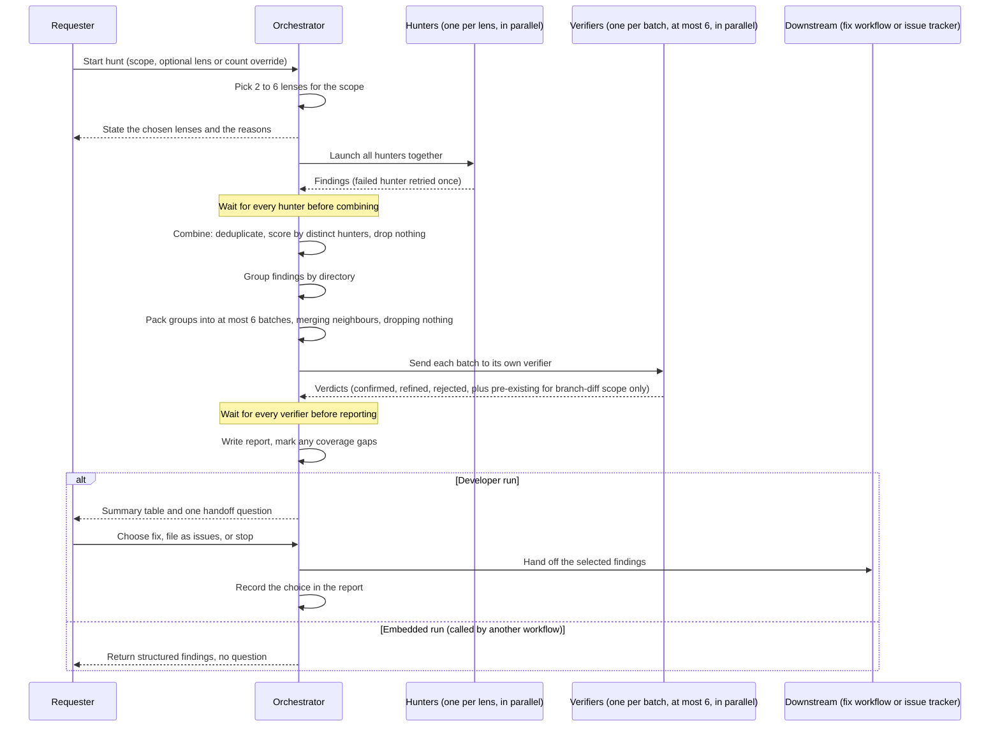
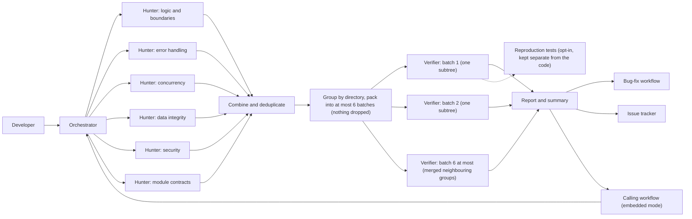
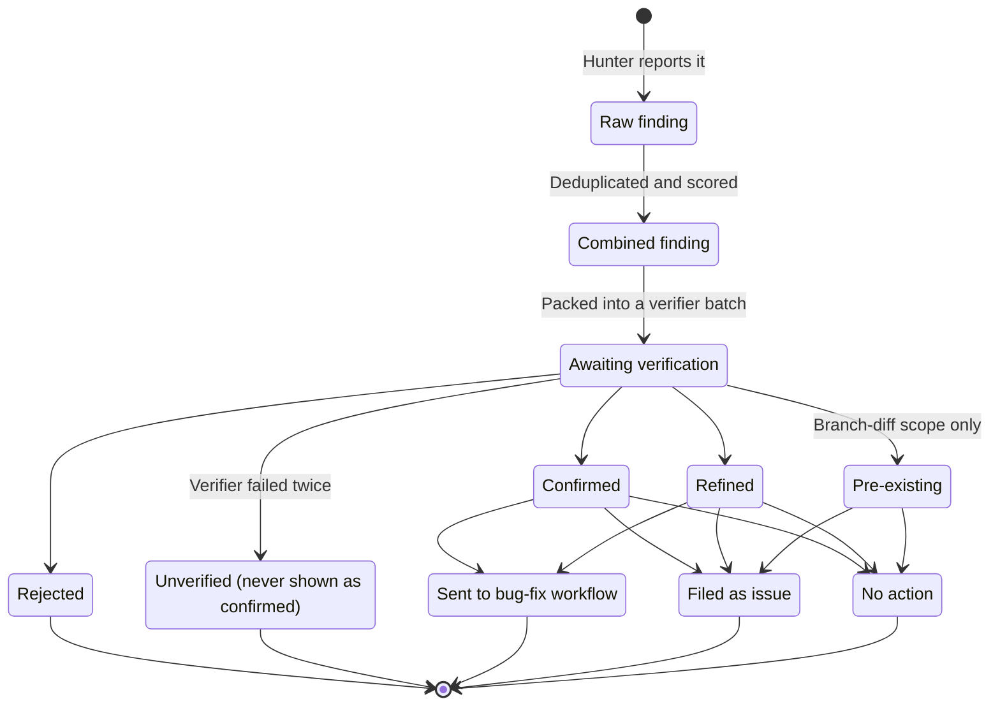

# Coordinated Multi-Agent Bug Hunting: Design for a Parallel Hunt-and-Verify Capability

## Summary

This design describes a new capability that looks for runtime bugs in a codebase. It runs several independent automated reviewers (called **hunters**) at the same time, and each one focuses on a different class of bug. Their findings are combined and duplicates are removed. Then a separate set of independent checkers (called **verifiers**) confirms or rejects each finding before anything reaches a person. The result is a short, trustworthy list of real bugs, each with a clear verdict, and one simple next step: fix the bugs, file them as issues, or stop.

## Context & problem

**Current state.** An existing bug-hunting helper can already run several copies of itself on the same code. Each copy picks its own focus at random from a small set of areas and styles. Because the picks are random and uncoordinated, the copies often land on the same area and report the same bugs, while other bug classes get no attention at all.

**Pain points.**

- **Collisions and gaps.** Random self-selection wastes effort on duplicate coverage and leaves blind spots.
- **Noisy output.** Without a combining step, the same bug shows up several times in slightly different wording.
- **Unverified claims.** Raw findings from an automated reviewer include false alarms. If those are presented as fact, people stop trusting the tool.
- **No clean handoff.** Once a bug is found, there is no structured way to pass it to the fix workflow or the issue tracker. Other automated workflows also have no way to call the hunt and get structured results back.

**Why change now.** Prior research on running reviewers in parallel points to a clear set of practices:

- Assign each reviewer a distinct focus deliberately.
- Keep reviewers isolated from each other, because letting them debate measurably lowers accuracy.
- Combine findings carefully, without throwing any away early.
- Verify findings independently before showing them to anyone.

This design applies those practices.

## Actors & systems

| Actor / system | Role | Permissions and ownership |
|---|---|---|
| **Developer (requester)** | Starts a hunt on demand, reviews the results, and chooses what happens next. | Owns the final decision. Nothing changes in their code unless they choose it. |
| **Calling workflow (embedded mode)** | Another automated workflow, such as a self-audit or the bug-fix workflow, that starts a hunt and consumes the results itself. **Embedded mode** means the hunt runs as a step inside another workflow: it receives a labeled request and returns structured findings without asking a person anything. | Receives findings. It is not asked a handoff question. |
| **Orchestrator** | The coordinator. It decides the scope, picks which bug classes to hunt for, launches hunters and verifiers, combines results, writes the report, and runs the handoff. | The only participant that sees every finding. It is the single point where results are combined. |
| **Hunters** | Independent reviewers, each assigned one **lens**. A lens is a single bug class to focus on. | Read-only access to the code in scope. They cannot see or message each other. |
| **Verifiers** | Independent checkers that judge each combined finding. Findings are grouped by directory and the groups are packed into at most 6 **verifier batches**; each verifier sees only the findings in its own batch. | Read-only by default. In the opt-in reproduction mode they may write a test, but only as a separate output. |
| **Bug-fix workflow** | Takes a confirmed finding and fixes it, one run per finding. | Invoked only when the developer chooses it. |
| **Issue tracker** | Records findings as issues so they can be fixed later. | Invoked only when the developer chooses it. |
| **Code-review capability (existing)** | Checks code for conventions, complexity and consistency. | A separate capability with a different job. It does not call the hunt today. |

**Candidate lenses** (bug classes):

1. Logic and boundary errors
2. Error handling and silent failures
3. Concurrency and asynchronous behavior
4. Data integrity
5. Security
6. Contract mismatches between modules

## Proposed design

### Scope of a hunt

- **Default:** the changes on the current branch compared with the main line of development.
- **Options:** a specific path, or the whole repository.
- **Not in scope:** style, conventions and complexity. Those belong to the existing code-review capability. This hunt looks only for bugs that would show up when the code runs.

### Choosing the hunters

- The orchestrator picks **2 to 6 lenses** that fit the scope. For example, a change that touches only page styling gets no concurrency hunter.
- Before launching anything, it states which lenses it picked and why, so the developer can see what will be covered.
- The developer can override the pick by naming specific lenses or by setting a hunter count.
- Each hunter gets exactly one lens. The orchestrator always assigns lenses deterministically and never lets hunters choose their own. This removes the collisions and gaps described above.

### Running the hunt

- All hunters start together and work in parallel.
- Hunters are fully isolated. They do not see each other's work and cannot exchange messages, so each perspective stays independent.
- The orchestrator waits until every hunter has finished, including any retries, before it combines anything. A run never moves on with only part of the results. This makes the hunt an **atomic fan-out**: it has either not started or fully finished.

### Combining findings

- **Deduplication.** Findings that point at the same file within two lines of each other count as one finding.
- **Confidence.** Confidence goes up when *different hunters* independently report the same issue. It does not go up because a finding matches several lenses, since one reviewer flagging something twice is not independent evidence.
- **Nothing dropped early.** Every finding, even a low-confidence one, goes on to verification. Filtering happens only after an independent check.

### Verification

- **Grouping.** The combined findings are first grouped by the directory they point at.
- **Packing into batches.** A **verifier batch** is the set of findings one verifier receives. There are never more than 6 batches, because the verifier limit is fixed.
  - If there are 6 directory groups or fewer, each group becomes its own batch.
  - If there are more than 6, the orchestrator merges groups until 6 batches remain. It first merges neighbouring groups, meaning directories that sit close together in the same part of the folder tree, and it starts with the smallest groups. This keeps each batch one coherent part of the codebase wherever possible. Unrelated groups are combined only when no neighbour is left.
  - **No finding is ever dropped to fit the limit.** The limit changes how findings are batched, never how many get checked.
- Each verifier sees only its own batch, which keeps its judgment focused and independent.
- **Verdicts.** Each finding gets one of these verdicts:
  - **Confirmed:** it is a real bug.
  - **Refined:** it is a real bug, but the description or location has been corrected.
  - **Rejected:** it is not a real bug.
  - **Pre-existing:** it is real, but it was not introduced by the change in scope.
- **Pre-existing applies only to branch-diff hunts.** This verdict needs a baseline, meaning an earlier version of the code to compare against. Only the default scope, the branch's changes, has one. A hunt on a specific path or on the whole repository has no baseline, so only confirmed, refined and rejected are used, and an old but real bug is simply confirmed or refined.
- **Opt-in reproduction mode.** For confirmed findings rated critical or high, a verifier writes a **reproduction test**: an automated test that fails because of the bug. The test is delivered as a separate output and is never applied to the developer's code automatically. The developer decides whether to use it. A default run only reviews and changes nothing.

### Results and handoff

- A full report is saved alongside other generated artifacts, and a short summary table is shown to the developer.
- The developer is then asked **one** question: send selected findings to the bug-fix workflow (one run per finding), file them in the issue tracker, or stop.
- The developer's choice is recorded in the report.
- **Embedded mode:** no question is asked. The structured findings go straight back to the calling workflow.

### Trust and safety model

- **Review-only by default.** A standard run never modifies the code under review.
- **Reproduction tests are never applied automatically.** They stay separate until a person chooses to use them.
- **Isolation as a correctness measure.** Hunters cannot influence each other, and each verifier sees only its own group. This prevents groupthink and keeps verdicts independent.
- **An honest presentation of findings.** A finding that was never verified is labeled unverified and is never shown as confirmed.
- **Fixed cost ceiling.** At most 6 hunters and at most 6 verifiers per run. These limits are built in and cannot be changed through options, which keeps cost and runtime predictable.

### Failure handling

- If a hunter or verifier fails, it is retried once.
- If it fails again, the run continues without it, and the report marks the missing lens, or the missing verifier batch together with every directory group it held, as a **coverage gap**. The developer can then see exactly what was not checked.

### Key decisions and rationale

| Decision | Rationale |
|---|---|
| Lenses are assigned deterministically | Random self-selection causes repeated collisions and leaves blind spots. |
| Hunters stay isolated | Letting reviewers debate measurably reduces accuracy. Independent views catch more. |
| Confidence rises with distinct hunters, not lenses | Only agreement between independent reviewers is real corroboration. |
| Nothing is dropped before verification | Early filtering silently loses real bugs that happened to look low-confidence. |
| Verifiers are grouped by directory | Related code gets checked together, while each verifier's view stays small and independent. |
| Extra directory groups are packed into batches, never dropped | The fixed limit keeps cost predictable, and packing neighbours together keeps each batch coherent without losing any finding. |
| Pre-existing is used only for branch-diff hunts | Without a baseline there is no way to tell whether a bug is new, so the verdict would be a guess. |
| One handoff question | It keeps the end of the run simple, and the developer stays in control. |
| A separate capability from code review | Bug hunting and convention review are different jobs, and each stays focused. |

## Diagrams

Diagrams rendered in Mermaid — Excalidraw not available at generation time.

**Diagram 1 — One hunt, end to end.** The requester starts a hunt. The orchestrator states its lens pick, runs all hunters in parallel, and waits for every one before it combines findings. It then packs the directory groups into at most 6 verifier batches and runs one verifier per batch in parallel. The pre-existing verdict appears only when the scope is a branch diff. A developer gets a report and one handoff question, while a calling workflow gets structured findings back with no question.

**Diagram 2 — Who talks to whom.** Hunters have no links to each other, and neither do verifiers. All combining happens in the orchestrator, which also packs directory groups into at most 6 verifier batches. Reproduction tests are kept apart from the developer's code. A person can start a hunt directly, or another workflow can start it in embedded mode.

**Diagram 3 — The life of a finding.** A raw finding is combined with any duplicates and then verified. It ends with a verdict, or it is marked unverified if its verifier batch failed twice. The pre-existing verdict is reachable only when the hunt's scope is a branch diff; path and whole-repository hunts end in confirmed, refined or rejected. An unverified finding is never shown as confirmed. Confirmed and refined findings can go on to be fixed, filed as issues, or left alone.

## Alternatives considered

| Alternative | Why it was ruled out or deferred |
|---|---|
| **Let each hunter pick its own focus at random** (current behavior) | It causes frequent collisions and coverage gaps. This is the main problem the design solves. |
| **Let hunters discuss and debate findings** | Prior research shows that debate between reviewers measurably lowers accuracy through groupthink. Isolation keeps perspectives independent. |
| **Fold bug hunting into the existing code-review capability** | They do different jobs. Review covers conventions and complexity, while this hunt covers runtime bugs. Keeping them separate keeps both focused. Code review may call the hunt as a gate later through embedded mode, but that is deferred. |
| **Make the hunter and verifier limits configurable** | Fixed limits keep cost and runtime predictable and prevent runaway runs. The useful range of 2 to 6 lenses is already covered by the built-in selection and overrides. |
| **Drop low-confidence findings before verification** | Real bugs that happen to look weak would be lost silently. Verification is the right place to filter. |
| **Raise confidence when several lenses match a finding** | Lens overlap is not independent evidence. Only agreement between separate hunters counts. |
| **Raise the verifier limit, or skip some findings, when there are more than 6 directories** | A higher limit breaks the fixed cost ceiling, and skipping findings loses real bugs silently. Packing groups into batches keeps both the limit and every finding. |
| **Use the pre-existing verdict for every scope** | Path and whole-repository hunts have no baseline to compare against, so the verdict could not be given reliably. |
| **One verifier that sees everything** | It takes away independence between groups and gives one checker an unmanageably large view. Grouping by directory keeps each check focused. |
| **Apply reproduction tests or fixes automatically** | It changes the developer's code without consent. Review-only by default keeps the developer in control. |

## Open questions / risks

**Risks and mitigations**

- **Partial coverage after failures.** A hunter or verifier that fails twice leaves a gap. *Mitigation:* the report names the missing lens, or the missing batch and its directory groups, so the gap is visible instead of silent.
- **Run cost.** Up to 12 automated reviewers per run (6 hunters and 6 verifiers) can be expensive on large scopes. *Mitigation:* fixed limits, a lens pick sized to the scope, and a default scope of only the current branch's changes.
- **Over-trusting verdicts.** Automated verification can still be wrong. *Mitigation:* the verdict scheme, the rule that unverified findings are never shown as confirmed, and optional reproduction tests for the most serious findings.
- **Waiting for the slowest agent.** Because the orchestrator waits for every agent, one slow agent delays the whole run. This trade-off is accepted in exchange for simple, all-or-nothing results.
- **Directory grouping vs. cross-cutting bugs.** A bug that spans several directories may be split across verifiers who each see only part of it. Packing neighbouring groups together reduces this somewhat, but it is still worth watching during early use.
- **Large batches on wide scopes.** A whole-repository hunt that touches many directories packs more findings into each of the 6 batches, so each verifier has more to judge. *Mitigation:* neighbouring groups are merged first so batches stay coherent; if batches prove too large in practice, the limit can be revisited as a deliberate design change.

**Success criteria**

- **Release gate.** A small test codebase with about 6 planted bugs, one per lens, must meet three targets:
  - at least 4 of the planted bugs are found;
  - the results contain zero duplicate rows;
  - rejected findings are never shown as confirmed.

  This check is recorded as a standing smoke test, which is a quick check re-run before each release.
- **After release.** Informally track the **resolution rate**: the share of reported findings that were actually fixed or filed through the handoff. This is recorded in each report.

**Open questions**

- When should the existing code-review capability start calling the hunt as a gate in embedded mode? This is out of scope for now, but embedded mode leaves room for it.
- Does a resolution rate tracked only informally give enough signal to tune lens selection, or will a more formal measure be needed later?
- How should lens selection handle mixed scopes where a small part of a large change carries most of the risk?
